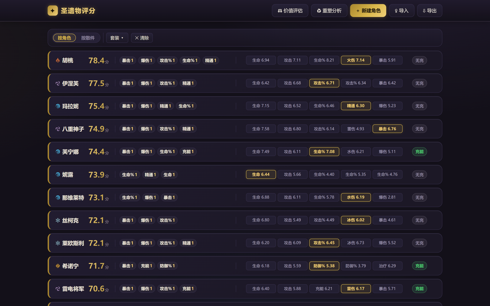
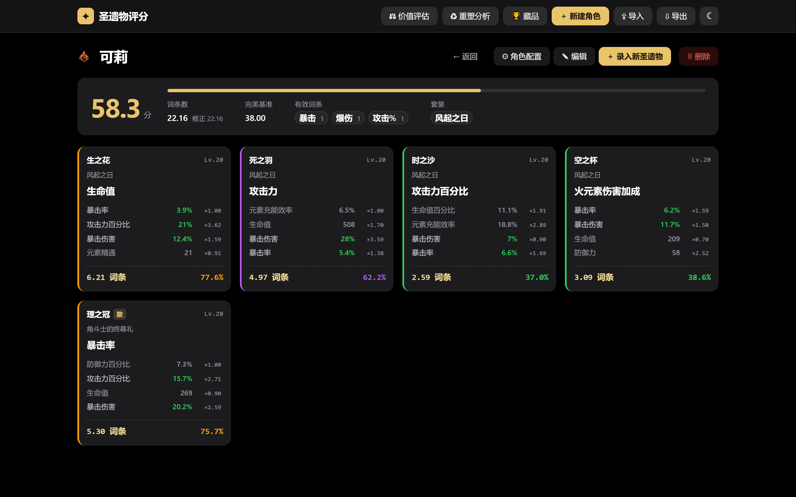
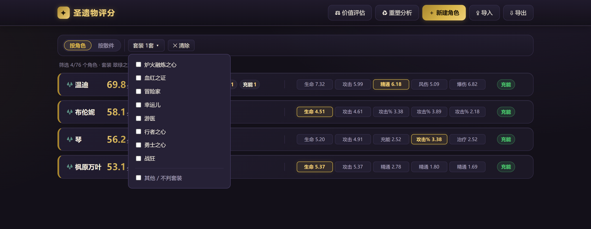

# 圣遗物评分工具

<div align="center">


</div>

原神圣遗物配置管理网页：保存并管理各角色的圣遗物配置，量化评估圣遗物词条价值，为「强化还是替换」提供决策参考。

纯前端实现（原生 HTML/CSS/JS，无框架、无构建步骤），数据保存在浏览器 localStorage，支持导出 / 导入 / 合并 JSON 备份。

## 功能特性

**四大核心算法**

- **单件词条计算**：基于滚数当量（显示值 ÷ 词条上限 × 词条权值，仅统计有效词条）量化单件圣遗物
- **角色评分**：以「客观完美态」为满分基准（随角色的有效词条与权值动态计算，非固定目标值），支持散件与套装件双模式；元素充能效率作为达标型属性处理（超额惩罚、不足提示）
- **圣遗物价值评估**：区分「作为散件 / 自由件」与「作为同部位同套装同主词条的套装件」两种情形，结合当前评分与强化潜力给出强化 / 替换建议；未设置散件位（5 件全套装）时按**冗余位**自动识别自由位——5 个部位均可评估异套件（原神无 5 件套效果，换掉任一件都不损失套装效果）
- **重塑价值评估（算法四）**：为满级圣遗物的「启圣之尘重塑」提供期望收益决策——按三情况归属（原地强化 / 同套转移 / 晋升套装件）确定评估对象，统一 RV = 重塑后期望分 − 功能位现状分，支持三档保底（基础/高阶/谕告）与三情况开关过滤

**其他能力**

- **重塑分析视图**：逐件给出「建议指定词条 → 现状 → 期望」对比与每尘收益；3/4 初始由副词条档位分解自动推断（发数守恒：4 初始 = 9 发 / 3 初始 = 8 发）——推断确定时静态展示，档位两可时提供手动切换
- **角色配置**：为每个角色设定有效词条与权值（决定评分基准）、散件位与充能需求；新建角色时按元素映射表（77 位）自动带出元素。仓库 `backups/` 内附现成角色数据备份（76 位），用「导入」即可直接使用
- **文本快速录入**：粘贴游戏内圣遗物文本自动解析主词条 / 副词条，支持自定义套装名识别（自定义套装置顶显示并参与筛选）
- **潜力评估**：`potential = 当前评分 + 待激活贡献 + 剩余可强化空间 × 最大词条权值`——未满级判强化价值、满级判替换价值
- **3/4 词条初始圣遗物**：通过「待激活」状态支持未激活词条的录入
- **数据管理**：localStorage 持久化，带版本化 migrate 数据迁移，防丢字段；JSON 导出 / 导入 / 合并（并集）
- **首页筛选（双路径）**：①按角色 = **角色套装字段**多选过滤（四件套 / 两个两件套；留空 = 「其他」不判套装）；②按散件 = 散件部位 + 主词条过滤（两条件 AND 叠加，均可单独使用）；两条路径互斥、切换即清空另一路；筛选状态可持久化，刷新自动恢复上次路径与条件
- **角色套装字段**：每个角色固化「所穿套装」（1 个 = 四件套 / 2 个 = 两个两件套 / 留空 = 其他），作为套装类判定的唯一来源；圣遗物实况与声明不符时在详情页黄色提示 + 一键「按实况更新」（不自动改写）
- **藏品库（2026-10-11）**：集中保存**未装备给任何角色**的圣遗物（「极限单件」收藏）。按「部位 + 主词条」分桶（26 个桶），桶内按 6 个维度（攻击% / 生命% / 防御% / 精通 / 充能 / 双爆）各收藏一件最大值；一件藏品可同时占据多个维度位，被新件**完全取代**（不再占任何位）才自动移除。价值评估结果内嵌「藏品视角」（入藏判定 / 刷新纪录 / 极限程度 / 满级潜力），藏品件按「游离件」口径参与重塑分析；藏品库随「导出 / 导入」一起备份

## 界面预览

<p align="center">
  
  <br>
  <sub>左：首页角色列表（评分排序 / 有效词条 / 充能达标状态）　　右：角色详情（套装字段 / 总分达成度 / 逐件圣遗物滚数当量与达成百分比）</sub>
</p>

<p align="center">
  <br>
  <sub>首页「按角色」套装筛选：按角色套装字段多选 +「其他 / 不判套装」（套装字段为空：留空「其他」或 5 部位未录全），与「按散件」路径互斥</sub>
</p>

## 快速开始

无需安装依赖、无需构建：直接用浏览器打开 `index.html` 即可使用。

## 运行测试

```bash
# 算法层与文本识别回归测试（360 条用例，Node 环境）
node test.js

# DOM 集成冒烟测试（需 jsdom：npm i jsdom）
node test-dom.js
```

## 项目结构

```
index.html                 入口页面
css/style.css              全部样式（设计 token 集中在文件顶部 :root）
js/
  constants.js             常量（词条上限、套装列表与别名、元素表等）
  data.js                  数据校验（圣遗物 / 角色字段规则与警示，对应实现方案 §2.8）
  parser.js                圣遗物文本解析（含自定义套装识别）
  core.js                  四大核心算法实现（词条计算 / 角色评分 / 价值评估 / 重塑评估）
  adapters.js              数据适配层
  store.js                 状态管理
  storage.js               localStorage 持久化与 migrate
  io.js                    导出 / 导入 / 合并
  ui.js                    界面渲染与交互
  feedback.js              弹窗 / 通知等反馈组件
  main.js                  入口
assets/elements/           元素图标
test.js                    算法回归测试
test-dom.js                jsdom 页面冒烟测试
docs/                      设计与开发文档（背景知识 / 算法设计 / 实现方案 / UI 优化说明）
backups/                   网页导出的数据 JSON 备份（随仓库版本化保存）
```

## 设计文档

| 文档 | 内容 |
| --- | --- |
| [docs/圣遗物评分算法设计.md](docs/圣遗物评分算法设计.md) | 四大算法的完整设计：公式、伪代码与定稿示例数据（含第五章重塑价值评估） |
| [docs/圣遗物网页实现方案.md](docs/圣遗物网页实现方案.md) | 网页实现方案：架构、模块划分与数据模型 |
| [docs/圣遗物背景知识总结.md](docs/圣遗物背景知识总结.md) | 圣遗物系统背景知识（词条类型、数值上下限、重塑规则等） |
| [docs/UI优化说明.md](docs/UI优化说明.md) | UI 体系优化说明：设计 token、组件 class 体系与变更记录 |

## 免责声明

本项目为粉丝制作的个人工具，与 miHoYo / HoYoverse 无官方关联。项目中涉及的名称与图标素材版权归 miHoYo / HoYoverse 所有，仅作非商业用途展示。
